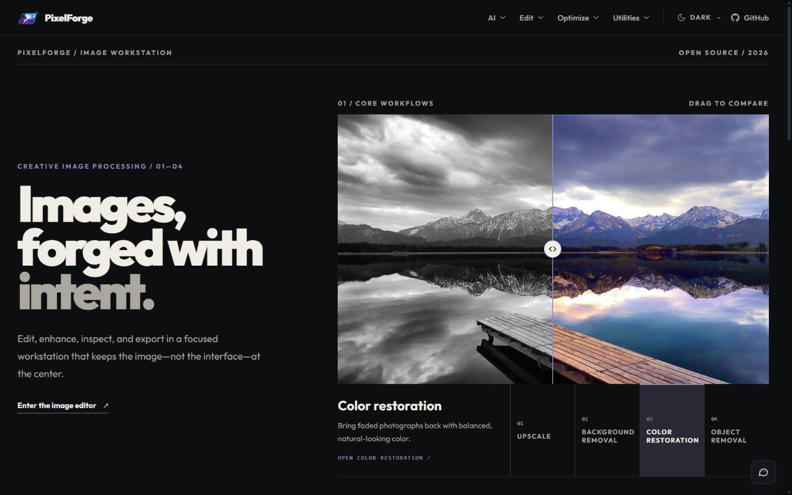
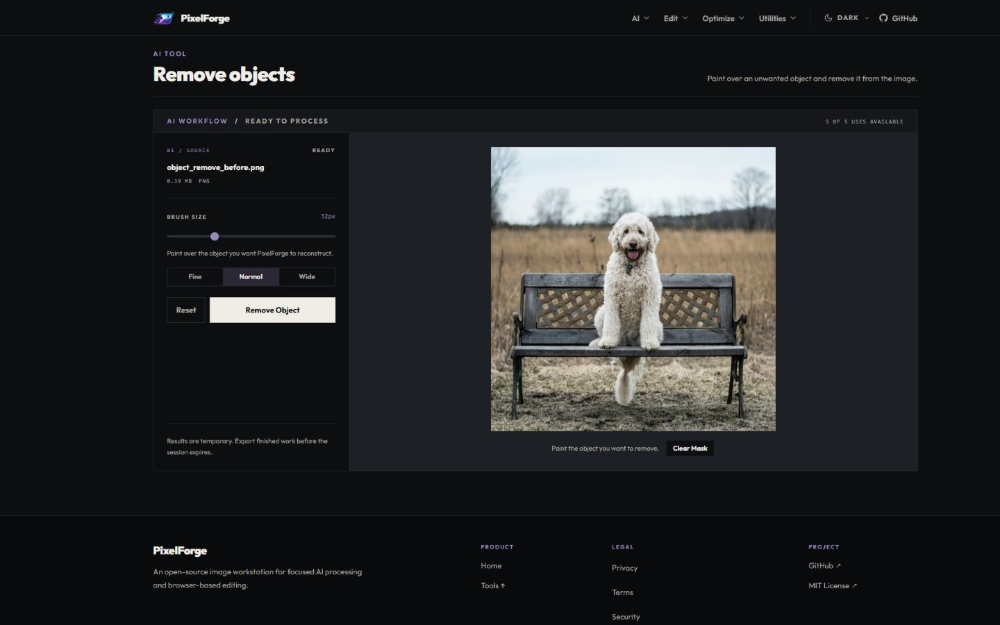
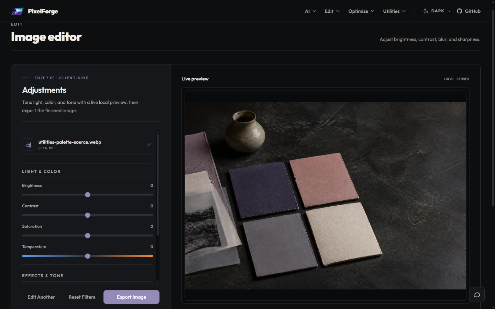

<h1 align="center">✨ PixelForge</h1>

<p align="center"><strong>An open-source image-processing workstation for AI enhancement, browser editing, inspection, and export.</strong></p>

<p align="center"><a href="./README.md">English</a> · <a href="./docs/translation/landing/README_CN.md">简体中文</a> · <a href="./docs/translation/landing/README_ID.md">Bahasa Indonesia</a></p>

<p align="center"><a href="#features">Features</a> · <a href="#architecture-highlights">Architecture</a> · <a href="#local-development">Setup</a> · <a href="#continuous-integration-quality-gate">Testing</a> · <a href="#developer-documentation">Documentation</a> · <a href="#contributors">Team</a></p>

<div align="center">

<a href="https://github.com/Yoruxyv/PixelForge/actions/workflows/quality.yml"></a>


<sub>React 19 · Vite 7 · FastAPI · PostgreSQL · Azure Blob Storage · Replicate · Cloudflare Turnstile</sub>

</div>

<a id="why-pixelforge"></a>

## 🚀 Why PixelForge

PixelForge combines cloud-powered AI enhancement with browser-based image editing in one workstation. Users can upscale or restore an image, remove its background or unwanted objects, then refine and export the result without switching applications.

Its processing model is deliberately hybrid: lightweight editing, conversion, and inspection run in the browser; AI-intensive work uses an asynchronous backend pipeline designed around external-provider latency, cost, and concurrency limits.

**What the design prioritizes**

- **Responsive editing:** browser-side tools avoid unnecessary network requests.
- **Controlled AI execution:** queues, concurrency limits, and usage quotas protect external-service capacity.
- **Private file handling:** file validation, signed upload/result URLs, and retention cleanup limit exposure.
- **Recoverable workflows:** client-side session persistence, explicit job states, and before/after comparisons help users resume work and assess results.
- **Extensibility:** an AI-provider abstraction keeps inference integration separate from application workflows.

<a id="product-preview"></a>

## 🖼️ Product Preview

### Homepage



### AI object removal



### Browser image editor



The screenshots show the homepage and two representative workspaces. Additional tools share the same navigation and workspace patterns.

<a id="features"></a>

## 🎯 Features

### AI workflows
- **Upscale Image** — increase resolution while preserving sharp details and clarity.
- **Remove Background** — create a clean, transparent subject cutout.
- **Restore Color** — bring grayscale or faded photos back with natural-looking color.
- **Remove Objects** — paint over an unwanted object and remove it from the image.

### Edit
- **Image Editor** — adjust brightness, contrast, saturation, blur, sharpness, and vignette.
- **Resize Image** — set exact dimensions with aspect-ratio locking and presets.
- **Crop Image** — reframe an image with freeform or preset aspect ratios.
- **Rotate & Flip** — correct orientation and composition with focused transform controls.

### Optimize
- **Compress Image** — reduce file size with direct quality control.
- **Convert Format** — export PNG, JPEG, or WebP images.
- **Remove Metadata** — strip EXIF and hidden metadata before sharing.

### Utilities and support
- **Color Palette** — sample an image and extract a practical working palette.
- **Add Watermark** — apply a text or image watermark with live preview.
- **PixelForge Assistant** — search the FAQ and open guided product shortcuts.
- **Feedback** — submit improvement ideas and bug reports from the application.

The responsive navigation uses shared SVG tool icons instead of external icon fonts. System, light, and dark themes share the same application shell. PWA assets include optimized favicons, an Apple touch icon, and 192 px/512 px install icons.

### Platform and system capabilities
- Turnstile verification, per-feature usage limits, and rate limiting
- Async AI jobs with queue capacity management and status polling
- IndexedDB/localStorage persistence and session restoration
- Signed Azure upload/result URLs and automated retention cleanup
- File type, size, spoofing, and resolution validation
- Browser-side downscaling for images above the public pixel limit
- Reusable image workspaces, comparison views, progress states, and export flows

<a id="architecture-highlights"></a>

## 🧠 Architecture Highlights

PixelForge is a full-stack application with a modular FastAPI backend, rather than a set of independently deployed microservices. The local Compose setup includes separate frontend, backend, and PostgreSQL services.

```text
Browser
├── Local tools: resize, crop, convert, compress, inspect, export
└── HTTP :8080
    └── Nginx / React frontend (container)
        └── /api/* → FastAPI backend :8000 (private container network)
                     ├── PostgreSQL :5432   → persistent usage data
                     ├── Azure Blob Storage → temporary uploads/results
                     └── Replicate          → external AI inference
```

| Component | Responsibility | State boundary |
| --- | --- | --- |
| React frontend | UI, client-side transformations, preview, session recovery | Browser memory, localStorage, IndexedDB |
| Nginx | Serves the built frontend and reverse-proxies `/api/` | Stateless serving/proxy layer |
| FastAPI | Validation, bot protection, quotas, AI job orchestration, polling, signed URLs | Request handlers are mostly stateless; in-memory job coordination is temporary process state |
| PostgreSQL | Usage limits and retention data | Persistent state in a Docker named volume |
| Azure Blob Storage | Input/output blobs and time-limited result access | Externally stored temporary files |
| Replicate | AI model inference | External processing service |

**Architectural decisions:** separate upload, processing, and result retrieval; bound concurrent jobs; poll asynchronous results; expire retained files; and keep the inference provider behind an abstraction. The API is **not entirely stateless** because job coordination and queues may live in backend process memory.

For implementation-level detail, see [Architecture](docs/ARCHITECTURE.md).

<a id="design-considerations"></a>

## 💡 Design Considerations

- **Async jobs instead of blocking requests:** AI inference can be slow and is constrained by external provider capacity.
- **Polling instead of persistent WebSocket connections:** a simpler request/response contract fits infrequent progress updates and browser reconnection.
- **Direct uploads via signed URLs:** moving image bytes directly to Azure reduces API bandwidth and limits the duration of granted access.
- **Rate limits and usage caps:** protect availability and control recurring inference costs.
- **Lifecycle cleanup:** expires temporary data rather than treating uploaded images as permanent assets.
- **Provider abstraction:** separates product logic from the chosen model integration.

<a id="processing-models"></a>

## 🔧 Processing Models

PixelForge uses two processing paths. AI operations are asynchronous and use backend services; lightweight image operations execute locally in the browser.

### 🔄 AI processing flow (asynchronous)

For cloud-based AI operations:

1. User selects an image
2. Frontend validates type, size, and resolution
3. Oversized but safe images are resized in the browser before upload
4. Backend verifies Turnstile and checks usage quota
5. Backend generates signed upload URL metadata
6. File uploads directly to Azure Blob Storage
7. Backend reserves queue capacity and increments usage when processing starts
8. AI provider executes the task asynchronously
9. Client polls job status via API
10. Result is stored with a signed access URL
11. Cleanup system removes expired data

### ⚡ Client-side processing flow (instant)

For resize, compress, transform, and similar operations, the file stays in the browser during processing:

1. User uploads image
2. Image processed directly in browser (resize, compress, transform, etc.)
3. No backend interaction required
4. Result generated instantly
5. User downloads processed file

<a id="environment-variables"></a>

## ⚙️ Environment Variables

PixelForge has **two configuration paths**: native development uses `backend/.env` and `frontend/.env`; Docker Compose reads a root `.env` file created from `.env.docker.example`. Do not confuse the two.

For native development, create the local environment files:

```bash
cp backend/.env.example backend/.env
cp frontend/.env.example frontend/.env
```

> Windows PowerShell: use `Copy-Item backend/.env.example backend/.env` and `Copy-Item frontend/.env.example frontend/.env`.

### Backend (`backend/.env`)

```env
ENVIRONMENT=development
DATABASE_URL=postgresql://postgres@localhost:5432/pixelforge
AZURE_CONNECTION_STRING=
REPLICATE_API_TOKEN=
CLOUDFLARE_TURNSTILE_SECRET_KEY=
DISCORD_WEBHOOK_URL=
ALLOWED_ORIGINS=http://localhost:5173,http://127.0.0.1:5173
ALLOW_TURNSTILE_TEST_BYPASS=false
TRUST_PROXY_HEADERS=false
TRUSTED_PROXY_CIDRS=
CLOUDFLARE_SUBNETS=
REQUIRE_CLOUDFLARE_PROXY=false
LOG_LEVEL=INFO
LOG_TO_FILE=false
LOG_DIR=logs
LOG_FILE_NAME=pixelforge.log
LOG_MAX_BYTES=10485760
LOG_BACKUP_COUNT=5
```

### Frontend (`frontend/.env`)

```env
VITE_API_BASE_URL=http://127.0.0.1:8000/api
VITE_TURNSTILE_SITE_KEY=
VITE_DEBUG_API=true
```

- Keep `DATABASE_URL`, Azure credentials, Replicate tokens, the Turnstile secret, and `DISCORD_WEBHOOK_URL` only in the backend environment.
- All `VITE_*` values are bundled into browser code and must be safe to expose publicly.
- `VITE_DEBUG_API=true` enables API debug logging only during local Vite development; keep it `false` in production.
- `LOG_TO_FILE=false` sends backend logs to stdout for container log collection. Set it to `true` for local rotating file logs when needed.
- Forwarded IP headers are ignored by default. Enable `TRUST_PROXY_HEADERS` only with explicit proxy CIDRs; never use `0.0.0.0/0` or `::/0`.
- `CLOUDFLARE_SUBNETS` is required only for verified Cloudflare proxy mode. `REQUIRE_CLOUDFLARE_PROXY` validates the proxy chain but does not firewall the origin.
- For deployment, replace local origins and URLs with the hosted frontend and backend addresses.

For step-by-step external-service setup, see [SETUP.md](./SETUP.md) for Azure Blob Storage, Replicate, Cloudflare Turnstile, PostgreSQL, Discord webhooks, and environment-variable guidance.

<a id="local-development"></a>

## 🚀 Local Development

### 1) Clone
```bash
git clone https://github.com/Yoruxyv/PixelForge.git
cd PixelForge
```

### 2) Start without Docker
Docker is optional. The launchers check frontend dependencies against `package-lock.json`, install missing dependencies, synchronize the backend environment from `uv.lock`, and launch both development servers. Install Node.js/npm and [uv](https://docs.astral.sh/uv/getting-started/installation/) first.

Windows:

```bat
scripts\windows\start_app.bat
```

Linux and macOS:

```bash
./scripts/unix/start_app.sh
```

On later runs, existing dependencies are reused. The frontend opens at `http://localhost:5173`, and the backend runs at `http://127.0.0.1:8000`.

### 3) Start manually
Backend:

Install [uv](https://docs.astral.sh/uv/getting-started/installation/) first. The backend workflow is the same on Windows PowerShell, Linux, and macOS:

```bash
cd backend
uv sync --locked
uv run python run.py  # starts Uvicorn with proxy header rewriting disabled
```

Frontend:

```bash
cd frontend
npm install
npm run dev
```

### 4) Run the complete stack with Docker Compose

Docker Desktop or Docker Engine with Compose v2 is required. The root `.env` controls the three-service stack; it is different from the native frontend/backend environment files above.

On Windows PowerShell:

```powershell
Copy-Item .env.docker.example .env
# Review .env; replace the development-only database password for shared deployments.
docker compose up -d --build
docker compose ps
```

On Linux/macOS, create `.env` using `cp .env.docker.example .env` before the same Compose commands.

- **Frontend:** `http://localhost:8080`
- **Backend health (via Nginx):** `http://localhost:8080/api/`
- **Backend API docs:** `http://localhost:8080/api/docs`
- **Logs:** `docker compose logs -f backend` or `docker compose logs --tail=200`
- **Inspect / exec:** `docker compose ps -q backend` provides the container ID for `docker inspect`; use `docker compose exec backend id` for a non-root identity check
- **Stop:** `docker compose down`; named PostgreSQL data survives. Avoid `down -v` unless intentionally deleting that data.

Browser-only tools and basic API health can run without AI provider credentials. To run AI workflows, supply valid Azure, Replicate, and Turnstile values in the **root** `.env`, configure the associated services, and rebuild when changing `VITE_TURNSTILE_SITE_KEY` (a build-time frontend value).

See the [Docker Compose setup guide](SETUP.md#docker-compose-production-like-local-stack) for networking, persistence, external-service configuration, and troubleshooting. This Compose configuration is a local, production-like stack, **not** a hardened public deployment.

### 5) Frontend quality checks

The blocking frontend checks run in GitHub Actions. Install Playwright Chromium before the first end-to-end run:

```bash
cd frontend
npm ci
npx playwright install chromium
npm run lint
npm run test -- --run
npm run build
npm run test:e2e
```

`npm run test:e2e:ui` enables interactive debugging. Failed CI runs upload Playwright reports, screenshots, and traces when available.

### 6) Backend quality checks

```bash
cd backend
uv lock --check
uv sync --locked
uv run ruff check .
uv run ruff format --check .
uv run pytest
uv run mypy
```

### Continuous integration quality gate

Pull requests and pushes to `master` validate:

- Frontend ESLint, Vitest, production builds, and Playwright Chromium end-to-end tests.
- **Lighthouse:** five desktop and five mobile production-preview runs. The Performance arithmetic mean must be **≥ 95** for each profile; every individual Performance run must be **≥ 90**. Accessibility, Best Practices, and SEO must each be **100**.
- Backend dependency-lock validation, Ruff lint/format, pytest, and mypy.
- Backend pytest compatibility on Python **3.11, 3.12, and 3.13**.
- Cross-platform scripts/tooling checks and documentation link validation.

The aggregate **Quality gate** passes only when all required checks pass. These checks do not substitute for verifying container builds and registry-pulled images in a release or coursework demonstration.

<a id="security-notes"></a>

## 🔒 Security Notes

- Fresh Turnstile verification before every AI job initialization and feedback submission
- Forwarded client-IP headers accepted only from configured trusted proxy CIDRs
- Missing Turnstile configuration fails closed outside local/development environments
- Signed SAS URLs for controlled blob access
- Strict file validation + capped dimensions/size
- Public AI uploads use a lower browser-side pixel limit for user experience
- Backend validation remains the security boundary with a higher hard pixel safety cap
- Oversized images may be resized before upload, while oversized files are still rejected by byte-size limits
- Automated cleanup for privacy and storage hygiene

<a id="contributing"></a>

## 🤝 Contributing
PRs and improvements are welcome.

If you’re planning a bigger change, open an issue first to align on scope.

For contributing guidelines, see [CONTRIBUTING.md](CONTRIBUTING.md).

Please follow our [Code of Conduct](CODE_OF_CONDUCT.md).

For security issues, please see our [Security Policy](SECURITY.md).

<a id="license"></a>

## 📜 License
Licensed under the MIT License. See [LICENSE](./LICENSE) for details.

<a id="developer-documentation"></a>

## 📝 Developer Documentation

- [System architecture and state boundaries](docs/ARCHITECTURE.md)
- [External-service and Docker setup](SETUP.md)

How to add a new AI feature to PixelForge:

- [Adding a New AI Feature](docs/ADDING_AI_FEATURE.md)

Frontend, Playwright, backend, and AI testing guidance:

- [Testing PixelForge](docs/TESTING.md) ([ID](docs/translation/dev/TESTING_ID.md), [ZH](docs/translation/dev/TESTING_ZH.md))

Developer helper scripts:
- Total Line Counter: [PowerShell](scripts/windows/dev/get_total_lines.ps1) / [Bash](scripts/unix/dev/get_total_lines.sh)
- Application launcher: [Windows BAT](scripts/windows/start_app.bat) / [Bash](scripts/unix/start_app.sh)
- Usage reset helper: [Windows BAT](scripts/windows/reset_usage.bat) / [Bash](scripts/unix/reset_usage.sh)

The paired wrappers share project logic across Windows, Linux, and macOS.

<a id="acknowledgements"></a>

## 🙏 Acknowledgements

- Real-ESRGAN ecosystem
- Replicate platform
- FastAPI, React, and open-source contributors

<a id="contributors"></a>

## 👤 Contributors

Made with ❤️ by the PixelForge team.

<table>
  <tr>
    <td align="center" width="180"><a href="https://github.com/Yoruxyv"><br/><strong>Hans</strong></a><br/><sub>Lead Developer</sub></td>
    <td align="center" width="180"><a href="https://github.com/Serthonss"><br/><strong>Wellson</strong></a><br/><sub>Project Coordinator</sub></td>
    <td align="center" width="180"><a href="https://github.com/vincentlawi"><br/><strong>Lawi</strong></a><br/><sub>UI/UX Designer</sub></td>
    <td align="center" width="180"><a href="https://github.com/Jensenix"><br/><strong>Jensen</strong></a><br/><sub>QA Lead & Stakeholder</sub></td>
  </tr>
</table>
