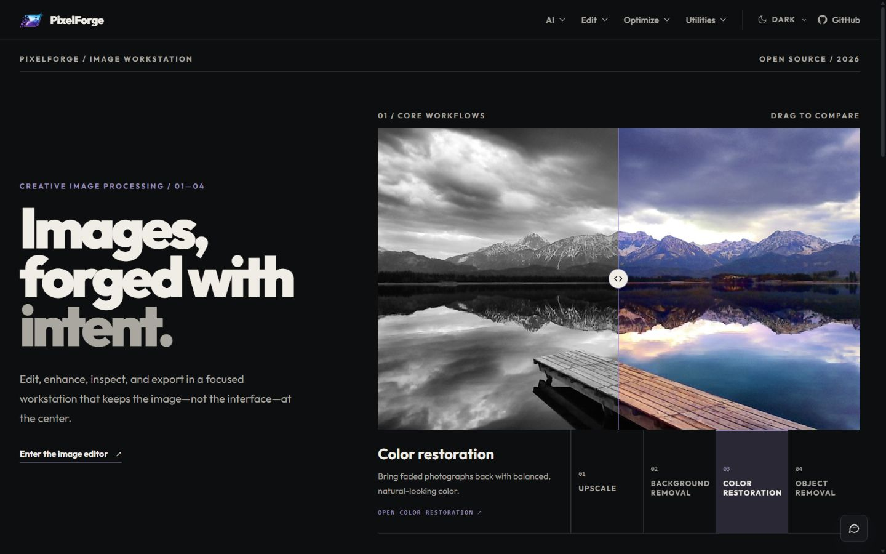
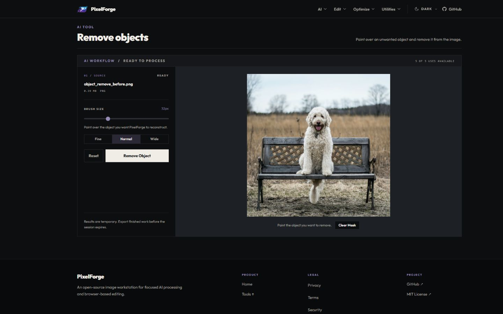
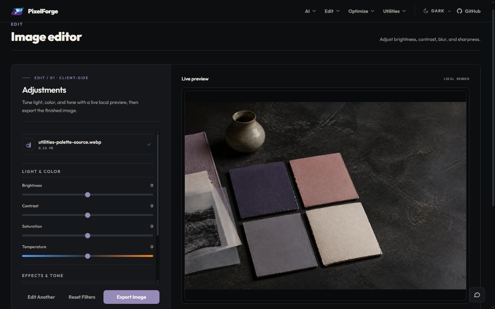

<h1 align="center">✨ PixelForge</h1>

<p align="center"><strong>集 AI 图像增强、浏览器端编辑、结果检查与导出于一体的开源图像处理工作台。</strong></p>

<p align="center"><a href="../../../README.md">English</a> · <a href="./README_CN.md">简体中文</a> · <a href="./README_ID.md">Bahasa Indonesia</a></p>

<p align="center"><a href="#功能特性">功能</a> · <a href="#架构概览">架构</a> · <a href="#本地开发">安装</a> · <a href="#持续集成质量门禁">测试</a> · <a href="#开发者文档">文档</a> · <a href="#贡献者">团队</a></p>

<div align="center">

<a href="https://github.com/Yoruxyv/PixelForge/actions/workflows/quality.yml"></a>


<sub>React 19 · Vite 7 · FastAPI · PostgreSQL · Azure Blob Storage · Replicate · Cloudflare Turnstile</sub>

</div>

<a id="为什么选择-pixelforge"></a>

## 🚀 为什么选择 PixelForge

PixelForge 将云端 AI 图像增强与浏览器端编辑整合在同一工作台中。用户可以放大或修复图像、移除背景或多余对象，然后继续调整并导出结果，无须在多个应用之间切换。

它采用混合处理模式：轻量的编辑、格式转换与检查直接在浏览器内完成；需要大量计算的 AI 任务则通过异步后端流水线执行，以适应外部模型服务的延迟、成本与并发限制。

**核心设计目标**

- **响应迅速的编辑体验：** 浏览器端工具避免不必要的网络请求。
- **可控的 AI 执行：** 通过任务队列、并发上限与使用配额保护外部服务资源。
- **受保护的文件处理：** 文件验证、签名上传/结果 URL 与定期清理降低数据暴露风险。
- **可恢复的工作流程：** 浏览器端会话持久化、明确的任务状态以及前后对比帮助用户继续处理和评估结果。
- **可扩展性：** AI 提供商抽象层将推理服务集成与应用工作流程解耦。

<a id="产品预览"></a>

## 🖼️ 产品预览

### 首页



### AI 对象移除工作台



### 浏览器图像编辑器



以上截图展示首页和两个具有代表性的工作台。其他工具采用一致的导航与工作台设计。

<a id="功能特性"></a>

## 🎯 功能特性

### AI 工作流程

- **Upscale Image：** 提高图像分辨率，同时尽可能保留清晰度和细节。
- **Remove Background：** 分离主体并输出透明背景图像。
- **Restore Color：** 为黑白或褪色照片恢复自然的色彩。
- **Remove Objects：** 标记并移除图像中不需要的对象。

### 编辑

- **Image Editor：** 调整亮度、对比度、饱和度、模糊、锐度和暗角。
- **Resize Image：** 通过宽高比锁定和预设设置精确尺寸。
- **Crop Image：** 按自由比例或预设比例裁剪图像。
- **Rotate & Flip：** 旋转和翻转图像，校正方向与构图。

### 优化

- **Compress Image：** 控制质量以减小文件大小。
- **Convert Format：** 导出 PNG、JPEG 或 WebP 格式。
- **Remove Metadata：** 在分享前清除 EXIF 和其他隐藏元数据。

### 实用工具与支持

- **Color Palette：** 使用可拖动的采样点提取图像配色方案。
- **Add Watermark：** 添加文本或图像水印并实时预览。
- **PixelForge Assistant：** 搜索常见问题并打开产品操作指南入口。
- **Feedback：** 在应用内提交改进建议和问题报告。

响应式导航使用统一的 SVG 工具图标，而非外部图标字体。跟随系统、浅色和深色主题共用同一应用框架。PWA 资源包括优化后的 favicon、Apple touch 图标，以及 192 px/512 px 安装图标。

### 平台与系统能力

- Turnstile 验证、按功能划分的使用配额和请求速率限制
- 通过队列容量管理和状态轮询执行异步 AI 任务
- 使用 IndexedDB/localStorage 持久化数据并恢复会话
- Azure 上传/结果签名 URL 与自动到期清理
- 文件类型、大小、伪装格式及分辨率验证
- 对超过公共像素限制的图像进行浏览器端缩小处理
- 可复用工作台、前后对比滑块、进度状态和导出流程
- 文件名清洗及用于法律声明和提示信息的模态框系统
- 对超过保留期限的 Azure 文件与 PostgreSQL 使用数据进行清理

<a id="架构概览"></a>

## 🧠 架构概览

PixelForge 是一款采用模块化 FastAPI 后端的全栈应用，**不是**由多个独立部署的微服务构成。其本地 Docker Compose 配置包含前端、后端和 PostgreSQL 三个独立服务。

```text
浏览器
├── 本地工具：resize、crop、convert、compress、inspect、export
└── HTTP :8080
    └── Nginx / React 前端（容器）
        └── /api/* → FastAPI 后端 :8000（容器内部网络）
                     ├── PostgreSQL :5432   → 持久化使用数据
                     ├── Azure Blob Storage → 临时上传与结果文件
                     └── Replicate          → 外部 AI 推理
```

| 组件 | 职责 | 状态边界 |
| --- | --- | --- |
| React 前端 | 界面、浏览器端图像转换、预览与会话恢复 | 浏览器内存、localStorage、IndexedDB |
| Nginx | 托管构建后的前端，并将 `/api/` 反向代理到后端 | 无状态的服务与代理层 |
| FastAPI | 验证、机器人防护、配额、AI 任务编排、轮询和签名 URL | 请求处理基本无状态，但任务协调依赖临时的进程内状态 |
| PostgreSQL | 使用配额和保留期限数据 | Docker 命名卷中的持久化状态 |
| Azure Blob Storage | 输入/输出文件及限时访问结果 | 外部存储中的临时文件 |
| Replicate | AI 模型推理 | 外部服务处理 |

**架构决策：** 将上传、处理和结果获取分开；限制并发任务；轮询异步结果；清理过期文件；通过抽象层隔离推理提供商。由于任务协调和队列可能保存在后端进程内存中，API **并非完全无状态**。

**模型归属：** PixelForge 通过 Replicate 集成由第三方托管的 AI 模型，不负责训练这些基础模型，也不声称拥有其所有权。项目自身的工程工作集中在浏览器工具、用户界面、验证、任务编排、存储集成及运行安全措施。

实现细节请参阅[架构文档](../dev/ARCHITECTURE_ZH.md)。

<a id="设计考量"></a>

## 💡 设计考量

- **异步任务而非阻塞请求：** AI 推理可能耗时较长，并受外部服务容量约束。
- **状态轮询而非持续的 WebSocket 连接：** 对不频繁的进度更新和浏览器重连，简单的请求/响应接口更合适。
- **通过签名 URL 直传：** 图像数据直接传送到 Azure，减少 API 带宽占用，并限制授权时间。
- **请求限速与使用配额：** 保障可用性并控制持续产生的推理费用。
- **生命周期清理：** 按保留期限删除临时数据，而不是永久保存上传图像。
- **服务提供商抽象：** 将产品逻辑与选定模型的集成分离。

<a id="处理模型"></a>

## 🔧 处理模型

PixelForge 使用两种处理路径：AI 操作通过后端异步执行，轻量图像操作则直接在浏览器中运行。

### 🔄 AI 处理流程（异步）

云端 AI 操作的步骤：

1. 用户选择图像。
2. 前端验证文件类型、大小和分辨率。
3. 对尺寸过大但仍安全的图像，先在浏览器内缩小后再上传。
4. 后端验证 Turnstile 并检查使用配额。
5. 后端生成签名上传 URL 的元数据。
6. 文件直接上传至 Azure Blob Storage。
7. 后端预留队列容量，并在开始处理时记录使用量。
8. AI 提供商异步执行任务。
9. 客户端通过 API 轮询任务状态。
10. 结果被保存，并通过签名 URL 提供访问。
11. 清理系统移除过期数据。

### ⚡ 浏览器端处理流程（即时）

对于调整大小、压缩、变换等操作，图像文件在处理期间保留在浏览器内：

1. 用户上传图像。
2. 浏览器直接处理图像（调整大小、压缩、变换等）。
3. 无须与后端交互。
4. 立即生成结果。
5. 用户下载处理后的文件。

<a id="环境变量"></a>

## ⚙️ 环境变量

PixelForge 有**两套配置方式**：原生开发使用 `backend/.env` 和 `frontend/.env`；Docker Compose 则读取由 `.env.docker.example` 创建的项目根目录 `.env` 文件。请勿混用。

在原生开发环境中创建配置文件：

```bash
cp backend/.env.example backend/.env
cp frontend/.env.example frontend/.env
```

> Windows PowerShell：使用 `Copy-Item backend/.env.example backend/.env` 和 `Copy-Item frontend/.env.example frontend/.env`。

### 后端（`backend/.env`）

```env
ENVIRONMENT=development
DATABASE_URL=postgresql://postgres@localhost:5432/pixelforge
AZURE_CONNECTION_STRING=
REPLICATE_API_TOKEN=
CLOUDFLARE_TURNSTILE_SECRET_KEY=
DISCORD_WEBHOOK_URL=
ALLOWED_ORIGINS=http://localhost:5173,http://127.0.0.1:5173
ALLOW_TURNSTILE_TEST_BYPASS=false
TRUST_PROXY_HEADERS=false
TRUSTED_PROXY_CIDRS=
CLOUDFLARE_SUBNETS=
REQUIRE_CLOUDFLARE_PROXY=false
LOG_LEVEL=INFO
LOG_TO_FILE=false
LOG_DIR=logs
LOG_FILE_NAME=pixelforge.log
LOG_MAX_BYTES=10485760
LOG_BACKUP_COUNT=5
```

### 前端（`frontend/.env`）

```env
VITE_API_BASE_URL=http://127.0.0.1:8000/api
VITE_TURNSTILE_SITE_KEY=
VITE_DEBUG_API=true
```

- 仅在后端环境中保存 `DATABASE_URL`、Azure 凭据、Replicate 令牌、Turnstile 密钥和 `DISCORD_WEBHOOK_URL`。
- 所有 `VITE_*` 变量会打包进浏览器代码，不能包含秘密信息。
- `VITE_DEBUG_API=true` 只用于本地 Vite 开发时的 API 调试日志；生产环境应设置为 `false`。
- `LOG_TO_FILE=false` 将后端日志输出到 stdout，供容器日志系统采集；需要本地轮转日志时可设置为 `true`。
- 默认忽略转发的客户端 IP 头。只有配置明确可信的代理 CIDR 后才启用 `TRUST_PROXY_HEADERS`；切勿使用 `0.0.0.0/0` 或 `::/0`。
- `CLOUDFLARE_SUBNETS` 仅在验证 Cloudflare 代理模式时需要。`REQUIRE_CLOUDFLARE_PROXY` 用于检查代理链，**不能替代**源站防火墙。
- 部署时，应将本地 origin 和 URL 替换为实际使用的前后端地址。

Azure Blob Storage、Replicate、Cloudflare Turnstile、PostgreSQL、Discord webhook 和环境变量的配置说明见[部署指南](../dev/SETUP_ZH.md)。

<a id="本地开发"></a>

## 🚀 本地开发

### 1) 克隆仓库

```bash
git clone https://github.com/Yoruxyv/PixelForge.git
cd PixelForge
```

### 2) 不使用 Docker 启动

Docker 不是必需的。启动脚本根据 `package-lock.json` 检查并安装缺少的前端依赖，通过 `uv.lock` 同步后端环境，随后启动两个开发服务器。请先安装 Node.js/npm 和 [uv](https://docs.astral.sh/uv/getting-started/installation/)。

Windows：

```bat
scripts\windows\start_app.bat
```

Linux 和 macOS：

```bash
./scripts/unix/start_app.sh
```

后续启动会复用现有依赖。前端地址为 `http://localhost:5173`，后端地址为 `http://127.0.0.1:8000`。

### 3) 手动启动

后端（Windows PowerShell、Linux 或 macOS）：

```bash
cd backend
uv sync --locked
uv run python run.py  # 启动 Uvicorn，禁用代理头重写
```

前端：

```bash
cd frontend
npm install
npm run dev
```

### 4) 通过 Docker Compose 启动完整服务

需要 Docker Desktop 或带 Compose v2 的 Docker Engine。项目根目录的 `.env` 控制三个容器服务，与前述原生开发环境变量文件不同。

Windows PowerShell：

```powershell
Copy-Item .env.docker.example .env
# 检查 .env；多人共用部署时应替换仅供开发使用的数据库密码。
docker compose up -d --build
docker compose ps
```

Linux/macOS：先运行 `cp .env.docker.example .env`，再执行相同的 Compose 命令。

- **前端：** `http://localhost:8080`
- **后端健康检查（经 Nginx）：** `http://localhost:8080/api/`
- **后端 API 文档：** `http://localhost:8080/api/docs`
- **日志：** `docker compose logs -f backend` 或 `docker compose logs --tail=200`
- **检查 / exec：** `docker compose ps -q backend` 可获取容器 ID 以供 `docker inspect` 使用；运行 `docker compose exec backend id` 验证非 root 用户身份。
- **停止：** `docker compose down`。PostgreSQL 数据保存在命名卷中。除非确实要删除数据，否则不要使用 `down -v`。

浏览器端工具和基本 API 健康检查不需要 AI 服务凭据。运行 AI 工作流程时，需要在**项目根目录** `.env` 中配置有效的 Azure、Replicate 和 Turnstile 凭据，并配置相应服务。修改 `VITE_TURNSTILE_SITE_KEY` 后需重新构建前端，因为它是构建时变量。

有关网络、持久化、外部服务及故障排查，请参阅 [Docker Compose 部署指南](../dev/SETUP_ZH.md)。这是一套接近生产环境的本地配置，**不代表**已经加固到可以直接公开部署。

### 5) 前端质量检查

以下强制性前端检查同样在 GitHub Actions 中运行。第一次执行端到端测试前需安装 Playwright Chromium：

```bash
cd frontend
npm ci
npx playwright install chromium
npm run lint
npm run test -- --run
npm run build
npm run test:e2e
```

`npm run test:e2e:ui` 可以交互式调试。CI 失败时会在可用情况下上传 Playwright 报告、截图和 trace。

### 6) 后端质量检查

```bash
cd backend
uv lock --check
uv sync --locked
uv run ruff check .
uv run ruff format --check .
uv run pytest
uv run mypy
```

<a id="持续集成质量门禁"></a>

### 持续集成质量门禁

针对 `master` 的推送和拉取请求会验证：

- 前端 ESLint、Vitest、生产构建，以及 Playwright Chromium 端到端测试。
- **Lighthouse：** 桌面与移动设备各运行五次生产预览测试。每种配置的 Performance 算术平均分须 **≥ 95**，单次 Performance 评分须 **≥ 90**；Accessibility、Best Practices 与 SEO 均须达到 **100**。
- 后端依赖锁定检查、Ruff lint/format、pytest 和 mypy。
- 后端 pytest 兼容 Python **3.11、3.12 和 3.13**。
- 跨平台脚本/工具检查以及文档链接验证。

只有全部必要检查通过，整体 **Quality gate** 才会通过。这些检查**不能代替**在发布或课程演示前对容器构建及从镜像仓库拉取的镜像进行验证。

<a id="安全说明"></a>

## 🔒 安全说明

- 每次初始化 AI 任务和提交反馈前均进行新的 Turnstile 验证
- 仅接受来自已配置可信代理 CIDR 的转发客户端 IP 头
- 在非本地/开发环境中，缺少 Turnstile 配置时默认拒绝访问
- 通过签名 SAS URL 控制 Blob 存储访问
- 严格验证文件格式、大小与尺寸上限
- 公共 AI 上传使用较低的浏览器端像素限制，以改善用户体验
- 后端验证仍是安全边界，并实施更高的硬性像素上限
- 超大图片可在上传前缩小，但超过字节限制的文件仍会被拒绝
- 自动清理临时文件，兼顾隐私与存储维护

<a id="参与贡献"></a>

## 🤝 参与贡献

欢迎 Pull Request 与改进建议。对于较大的改动，建议先创建 Issue 讨论范围。

请阅读[贡献指南](../community/CONTRIBUTING_ZH.md)、[行为准则](../community/CODE_OF_CONDUCT_ZH.md)及[安全政策](../community/SECURITY_ZH.md)。

<a id="许可证"></a>

## 📜 许可证

项目采用 MIT 许可证，详见 [LICENSE](../../../LICENSE)。

<a id="开发者文档"></a>

## 📝 开发者文档

- [系统架构与状态边界](../dev/ARCHITECTURE_ZH.md)
- [外部服务与 Docker 配置](../dev/SETUP_ZH.md)
- [添加新的 AI 功能](../dev/ADDING_AI_FEATURE_ZH.md)
- [PixelForge 测试指南](../dev/TESTING_ZH.md)（[EN](../../../docs/TESTING.md)、[ID](../dev/TESTING_ID.md)）

开发辅助脚本：

- 总行数统计：[PowerShell](../../../scripts/windows/dev/get_total_lines.ps1) / [Bash](../../../scripts/unix/dev/get_total_lines.sh)
- 应用启动：[Windows BAT](../../../scripts/windows/start_app.bat) / [Bash](../../../scripts/unix/start_app.sh)
- 使用次数重置：[Windows BAT](../../../scripts/windows/reset_usage.bat) / [Bash](../../../scripts/unix/reset_usage.sh)

跨平台包装脚本共享项目逻辑，使 Windows、Linux 与 macOS 上的工具行为保持一致。

<a id="致谢"></a>

## 🙏 致谢

- Real-ESRGAN 生态系统
- Replicate 平台
- FastAPI、React 及开源贡献者

<a id="贡献者"></a>

## 👤 贡献者

由 PixelForge 团队用 ❤️ 制作。

<table>
  <tr>
    <td align="center" width="180"><a href="https://github.com/Yoruxyv"><br/><strong>Hans</strong></a><br/><sub>首席开发者</sub></td>
    <td align="center" width="180"><a href="https://github.com/Serthonss"><br/><strong>Wellson</strong></a><br/><sub>项目协调员</sub></td>
    <td align="center" width="180"><a href="https://github.com/vincentlawi"><br/><sub>UI/UX 设计师</sub></td>
    <td align="center" width="180"><a href="https://github.com/Jensenix"><br/><strong>Jensen</strong></a><br/><sub>QA 负责人及干系人</sub></td>
  </tr>
</table>
