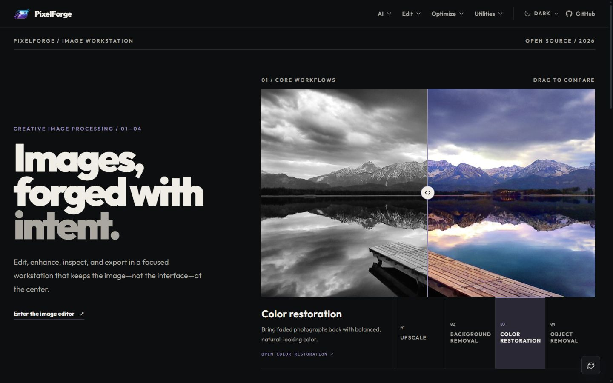
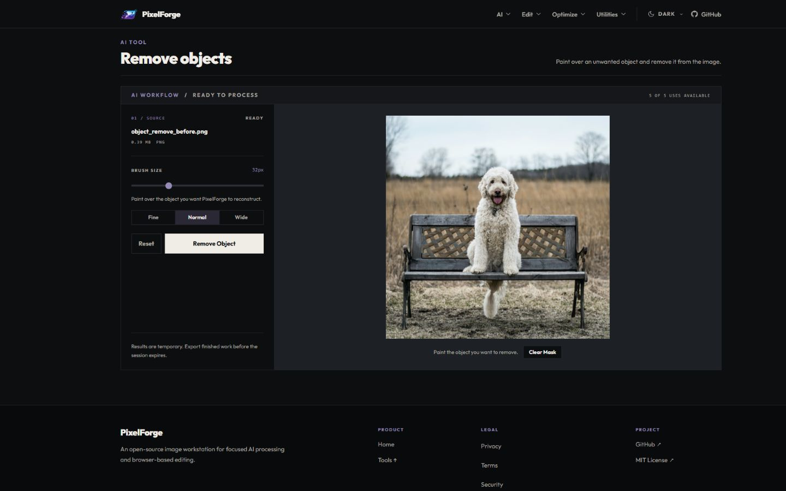
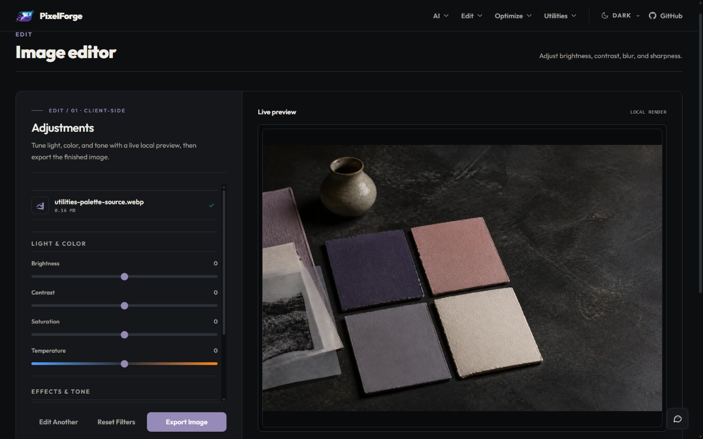

<h1 align="center">✨ PixelForge</h1>

<p align="center"><strong>Workstation pemrosesan gambar open-source untuk peningkatan kualitas berbasis AI, pengeditan di browser, pemeriksaan hasil, dan ekspor.</strong></p>

<p align="center"><a href="../../../README.md">English</a> · <a href="./README_CN.md">简体中文</a> · <a href="./README_ID.md">Bahasa Indonesia</a></p>

<p align="center"><a href="#fitur">Fitur</a> · <a href="#sorotan-arsitektur">Arsitektur</a> · <a href="#pengembangan-lokal">Instalasi</a> · <a href="#gerbang-kualitas-ci">Pengujian</a> · <a href="#dokumentasi-pengembang">Dokumentasi</a> · <a href="#kontributor">Tim</a></p>

<div align="center">

<a href="https://github.com/Yoruxyv/PixelForge/actions/workflows/quality.yml"></a>


<sub>React 19 · Vite 7 · FastAPI · PostgreSQL · Azure Blob Storage · Replicate · Cloudflare Turnstile</sub>

</div>

<a id="mengapa-pixelforge"></a>

## 🚀 Mengapa PixelForge

PixelForge menggabungkan peningkatan kualitas gambar berbasis AI di cloud dengan pengeditan langsung di browser. Pengguna dapat memperbesar atau memulihkan gambar, menghapus latar belakang maupun objek yang mengganggu, lalu menyempurnakan dan mengekspor hasilnya tanpa berpindah aplikasi.

Model pemrosesannya bersifat hibrida: pengeditan, konversi, dan inspeksi ringan dilakukan di browser, sedangkan tugas AI berjalan melalui pipeline backend asinkron yang mempertimbangkan latensi, biaya, dan batas konkurensi layanan eksternal.

**Prioritas perancangan**

- **Pengeditan responsif:** alat berbasis browser menghindari permintaan jaringan yang tidak diperlukan.
- **Eksekusi AI terkendali:** antrean, batas konkurensi, dan kuota penggunaan melindungi kapasitas layanan eksternal.
- **Penanganan berkas yang aman:** validasi, URL unggah/hasil bertanda tangan, dan penghapusan berkala mengurangi risiko paparan data.
- **Alur kerja yang dapat dipulihkan:** penyimpanan sesi di browser, status pekerjaan yang jelas, dan perbandingan sebelum/sesudah membantu pengguna melanjutkan pekerjaan.
- **Kemudahan pengembangan:** abstraksi penyedia AI memisahkan integrasi inferensi dari alur aplikasi.

<a id="pratinjau-produk"></a>

## 🖼️ Pratinjau Produk

### Beranda



### Penghapusan objek dengan AI



### Editor gambar di browser



Cuplikan di atas menunjukkan beranda dan dua workspace representatif. Alat lainnya menggunakan pola navigasi dan workspace yang konsisten.

<a id="fitur"></a>

## 🎯 Fitur

### Alur kerja AI

- **Upscale Image:** memperbesar resolusi gambar sambil mempertahankan detail dan ketajaman.
- **Remove Background:** memisahkan subjek dengan latar belakang transparan.
- **Restore Color:** mengembalikan warna pada foto pudar atau hitam-putih.
- **Remove Objects:** menandai objek yang tidak diinginkan untuk dihapus dari gambar.

### Pengeditan

- **Image Editor:** mengatur kecerahan, kontras, saturasi, blur, ketajaman, dan vignette.
- **Resize Image:** mengatur ukuran pasti dengan penguncian rasio aspek dan preset.
- **Crop Image:** memotong gambar menggunakan rasio bebas atau preset.
- **Rotate & Flip:** memutar dan membalik gambar untuk memperbaiki orientasi.

### Optimasi

- **Compress Image:** mengurangi ukuran berkas dengan pengaturan kualitas.
- **Convert Format:** mengekspor gambar sebagai PNG, JPEG, atau WebP.
- **Remove Metadata:** menghapus EXIF dan metadata tersembunyi sebelum berbagi.

### Utilitas dan dukungan

- **Color Palette:** mengambil sampel warna dengan titik yang dapat digeser dan menghasilkan palet yang dapat digunakan.
- **Add Watermark:** menambahkan watermark teks atau gambar dengan pratinjau langsung.
- **PixelForge Assistant:** menelusuri FAQ dan membuka pintasan panduan penggunaan.
- **Feedback:** mengirimkan saran perbaikan dan laporan masalah melalui aplikasi.

Navigasi responsif menggunakan ikon alat SVG bersama, bukan font ikon eksternal. Tema sistem, terang, dan gelap menggunakan kerangka antarmuka yang sama. Aset PWA mencakup favicon, ikon Apple touch, serta ikon instalasi 192 px/512 px yang dioptimalkan.

### Kemampuan platform dan sistem

- Verifikasi Turnstile, kuota per fitur, dan pembatasan laju permintaan
- Pekerjaan AI asinkron dengan pengelolaan kapasitas antrean dan polling status
- Penyimpanan IndexedDB/localStorage dan pemulihan sesi
- URL unggah/hasil Azure bertanda tangan dan pembersihan otomatis berdasarkan masa retensi
- Validasi jenis berkas, ukuran, pemalsuan tipe berkas, dan resolusi
- Downscaling di browser untuk gambar yang melampaui batas piksel publik
- Workspace yang dapat digunakan kembali, slider perbandingan sebelum/sesudah, status progres, dan alur ekspor
- Sanitasi nama berkas serta sistem modal untuk informasi legal dan peringatan
- Pembersihan data penggunaan PostgreSQL dan berkas Azure yang melewati masa retensi

<a id="sorotan-arsitektur"></a>

## 🧠 Sorotan Arsitektur

PixelForge adalah aplikasi full-stack dengan backend FastAPI yang modular, **bukan** kumpulan microservice yang diterapkan secara independen. Konfigurasi Docker Compose lokal terdiri atas tiga layanan terpisah: frontend, backend, dan PostgreSQL.

```text
Browser
├── Alat lokal: resize, crop, convert, compress, inspect, export
└── HTTP :8080
    └── Nginx / frontend React (container)
        └── /api/* → backend FastAPI :8000 (jaringan container internal)
                     ├── PostgreSQL :5432   → data penggunaan persisten
                     ├── Azure Blob Storage → unggahan/hasil sementara
                     └── Replicate          → inferensi AI eksternal
```

| Komponen | Tanggung jawab | Batas penyimpanan status (*state*) |
| --- | --- | --- |
| Frontend React | Antarmuka, transformasi di browser, pratinjau, dan pemulihan sesi | Memori browser, localStorage, IndexedDB |
| Nginx | Menyajikan frontend dan meneruskan `/api/` ke backend | Lapisan penyajian/proxy stateless |
| FastAPI | Validasi, perlindungan bot, kuota, orkestrasi pekerjaan AI, polling, URL bertanda tangan | Handler sebagian besar stateless, tetapi koordinasi pekerjaan dalam memori bersifat sementara |
| PostgreSQL | Data batas penggunaan dan retensi | Data persisten di Docker named volume |
| Azure Blob Storage | Penyimpanan berkas masukan/keluaran dan akses hasil terbatas waktu | Berkas sementara di penyimpanan eksternal |
| Replicate | Inferensi model AI | Pemrosesan oleh penyedia eksternal |

**Keputusan arsitektural:** pisahkan tahap unggah, pemrosesan, dan pengambilan hasil; batasi pekerjaan paralel; gunakan polling; hapus berkas yang melewati masa retensi; dan tempatkan integrasi inferensi di balik abstraksi penyedia. API **tidak sepenuhnya stateless** karena koordinasi pekerjaan dan antrean dapat tersimpan di memori proses backend.

**Kepemilikan model:** PixelForge mengintegrasikan model AI yang dihosting oleh Replicate. Proyek ini tidak melatih atau mengklaim kepemilikan model AI dasarnya. Rekayasa aplikasinya berfokus pada alat browser, antarmuka pengguna, validasi, orkestrasi pekerjaan, penyimpanan, dan pengamanan operasional.

Detail implementasi tersedia di [Arsitektur](../dev/ARCHITECTURE_ID.md).

<a id="pertimbangan-desain"></a>

## 💡 Pertimbangan Desain

- **Pekerjaan asinkron, bukan permintaan yang memblokir:** inferensi AI dapat berlangsung lama dan dibatasi oleh kapasitas penyedia.
- **Polling, bukan koneksi WebSocket persisten:** kontrak permintaan/respons lebih sederhana untuk pembaruan progres berkala dan pemulihan koneksi browser.
- **Unggah langsung memakai URL bertanda tangan:** berkas dipindahkan langsung ke Azure sehingga penggunaan bandwidth API berkurang dan akses dapat dibatasi waktunya.
- **Rate limit dan kuota:** menjaga ketersediaan layanan sekaligus mengendalikan biaya inferensi.
- **Pembersihan siklus hidup:** data sementara dihapus sesuai masa retensi, bukan disimpan selamanya.
- **Abstraksi penyedia:** memisahkan logika produk dari integrasi model AI yang dipilih.

<a id="model-pemrosesan"></a>

## 🔧 Model Pemrosesan

PixelForge menggunakan dua jalur: tugas AI berjalan secara asinkron melalui backend, sedangkan operasi gambar yang ringan diproses langsung di browser.

### 🔄 Alur pemrosesan AI (asinkron)

Untuk operasi berbasis cloud:

1. Pengguna memilih gambar.
2. Frontend memvalidasi jenis, ukuran, dan resolusi berkas.
3. Gambar yang terlalu besar tetapi masih aman diperkecil di browser sebelum diunggah.
4. Backend memverifikasi Turnstile dan kuota penggunaan.
5. Backend menghasilkan metadata URL unggah bertanda tangan.
6. Berkas diunggah langsung ke Azure Blob Storage.
7. Backend mencadangkan kapasitas antrean dan mencatat penggunaan saat pemrosesan dimulai.
8. Penyedia AI menjalankan tugas secara asinkron.
9. Klien melakukan polling status melalui API.
10. Hasil disimpan dan diakses melalui URL bertanda tangan.
11. Sistem pembersihan menghapus data yang kedaluwarsa.

### ⚡ Alur pemrosesan di browser (instan)

Untuk resize, compress, transformasi, dan operasi sejenis, berkas tetap berada di browser selama diproses:

1. Pengguna mengunggah gambar.
2. Browser langsung memproses gambar (resize, compress, transformasi, dan sebagainya).
3. Tidak diperlukan interaksi dengan backend.
4. Hasil dibuat secara langsung.
5. Pengguna mengunduh berkas hasil.

<a id="variabel-lingkungan"></a>

## ⚙️ Variabel Lingkungan

PixelForge memiliki **dua jalur konfigurasi**: pengembangan native menggunakan `backend/.env` dan `frontend/.env`, sedangkan Docker Compose membaca `.env` di direktori utama yang dibuat dari `.env.docker.example`. Jangan tertukar.

Untuk pengembangan native, buat berkas lingkungan lokal:

```bash
cp backend/.env.example backend/.env
cp frontend/.env.example frontend/.env
```

> Windows PowerShell: gunakan `Copy-Item backend/.env.example backend/.env` dan `Copy-Item frontend/.env.example frontend/.env`.

### Backend (`backend/.env`)

```env
ENVIRONMENT=development
DATABASE_URL=postgresql://postgres@localhost:5432/pixelforge
AZURE_CONNECTION_STRING=
REPLICATE_API_TOKEN=
CLOUDFLARE_TURNSTILE_SECRET_KEY=
DISCORD_WEBHOOK_URL=
ALLOWED_ORIGINS=http://localhost:5173,http://127.0.0.1:5173
ALLOW_TURNSTILE_TEST_BYPASS=false
TRUST_PROXY_HEADERS=false
TRUSTED_PROXY_CIDRS=
CLOUDFLARE_SUBNETS=
REQUIRE_CLOUDFLARE_PROXY=false
LOG_LEVEL=INFO
LOG_TO_FILE=false
LOG_DIR=logs
LOG_FILE_NAME=pixelforge.log
LOG_MAX_BYTES=10485760
LOG_BACKUP_COUNT=5
```

### Frontend (`frontend/.env`)

```env
VITE_API_BASE_URL=http://127.0.0.1:8000/api
VITE_TURNSTILE_SITE_KEY=
VITE_DEBUG_API=true
```

- Simpan `DATABASE_URL`, kredensial Azure, token Replicate, secret Turnstile, dan `DISCORD_WEBHOOK_URL` hanya di lingkungan backend.
- Seluruh nilai `VITE_*` masuk ke bundel JavaScript browser sehingga tidak boleh memuat rahasia.
- `VITE_DEBUG_API=true` hanya untuk pencatatan debug API selama pengembangan Vite; gunakan `false` pada produksi.
- `LOG_TO_FILE=false` mengarahkan log backend ke stdout agar dapat ditangkap sistem log container. Aktifkan `true` untuk log berotasi secara lokal bila diperlukan.
- Header IP yang diteruskan diabaikan secara default. Aktifkan `TRUST_PROXY_HEADERS` hanya dengan CIDR proxy tepercaya yang eksplisit; jangan gunakan `0.0.0.0/0` atau `::/0`.
- `CLOUDFLARE_SUBNETS` hanya diperlukan untuk mode proxy Cloudflare terverifikasi. `REQUIRE_CLOUDFLARE_PROXY` memeriksa rantai proxy, tetapi tidak menggantikan firewall origin.
- Saat deployment, ganti origin dan URL lokal dengan alamat frontend/backend yang digunakan.

Lihat [panduan SETUP](../dev/SETUP_ID.md) untuk konfigurasi Azure Blob Storage, Replicate, Cloudflare Turnstile, PostgreSQL, webhook Discord, dan variabel lingkungan.

<a id="pengembangan-lokal"></a>

## 🚀 Pengembangan Lokal

### 1) Clone repositori

```bash
git clone https://github.com/Yoruxyv/PixelForge.git
cd PixelForge
```

### 2) Menjalankan tanpa Docker

Docker bersifat opsional. Skrip peluncur memeriksa dependensi frontend berdasarkan `package-lock.json`, memasang yang belum lengkap, menyinkronkan lingkungan backend dari `uv.lock`, lalu menjalankan kedua server pengembangan. Pasang Node.js/npm dan [uv](https://docs.astral.sh/uv/getting-started/installation/) terlebih dahulu.

Windows:

```bat
scripts\windows\start_app.bat
```

Linux dan macOS:

```bash
./scripts/unix/start_app.sh
```

Pada penggunaan berikutnya, dependensi yang sudah tersedia digunakan kembali. Frontend berjalan di `http://localhost:5173` dan backend di `http://127.0.0.1:8000`.

### 3) Menjalankan secara manual

Backend (Windows PowerShell, Linux, atau macOS):

```bash
cd backend
uv sync --locked
uv run python run.py  # Uvicorn berjalan tanpa penulisan ulang header proxy
```

Frontend:

```bash
cd frontend
npm install
npm run dev
```

### 4) Menjalankan seluruh stack dengan Docker Compose

Diperlukan Docker Desktop atau Docker Engine dengan Compose v2. Berkas `.env` di root mengatur tiga layanan container dan berbeda dari berkas konfigurasi native sebelumnya.

Windows PowerShell:

```powershell
Copy-Item .env.docker.example .env
# Periksa .env; ganti kata sandi database khusus pengembangan jika digunakan bersama.
docker compose up -d --build
docker compose ps
```

Linux/macOS: jalankan `cp .env.docker.example .env`, kemudian gunakan perintah Compose yang sama.

- **Frontend:** `http://localhost:8080`
- **Kesehatan backend (melalui Nginx):** `http://localhost:8080/api/`
- **Dokumentasi API:** `http://localhost:8080/api/docs`
- **Log:** `docker compose logs -f backend` atau `docker compose logs --tail=200`
- **Inspect / exec:** `docker compose ps -q backend` menghasilkan ID container untuk `docker inspect`; gunakan `docker compose exec backend id` untuk memastikan identitas pengguna non-root.
- **Berhenti:** `docker compose down`. Data PostgreSQL tetap berada di named volume. Hindari `down -v` kecuali memang ingin menghapus data tersebut.

Alat berbasis browser dan endpoint kesehatan API dasar tetap dapat dijalankan tanpa kredensial penyedia AI. Untuk menjalankan alur AI, isi kredensial Azure, Replicate, dan Turnstile yang valid di `.env` **root**, konfigurasi layanan terkait, dan lakukan rebuild jika `VITE_TURNSTILE_SITE_KEY` diubah (nilai frontend saat build).

Lihat [panduan Docker Compose](../dev/SETUP_ID.md) untuk jaringan, persistensi, layanan eksternal, dan pemecahan masalah. Konfigurasi ini adalah stack lokal yang menyerupai produksi, **bukan** deployment publik yang sudah diperkeras sepenuhnya.

### 5) Pemeriksaan kualitas frontend

Pemeriksaan wajib frontend dijalankan melalui GitHub Actions. Pasang Chromium untuk Playwright sebelum tes end-to-end pertama:

```bash
cd frontend
npm ci
npx playwright install chromium
npm run lint
npm run test -- --run
npm run build
npm run test:e2e
```

Gunakan `npm run test:e2e:ui` untuk debugging interaktif. Laporan, screenshot, dan trace Playwright diunggah pada CI yang gagal jika tersedia.

### 6) Pemeriksaan kualitas backend

```bash
cd backend
uv lock --check
uv sync --locked
uv run ruff check .
uv run ruff format --check .
uv run pytest
uv run mypy
```

<a id="gerbang-kualitas-ci"></a>

### Gerbang kualitas CI

Push ke `master` dan pull request memvalidasi:

- ESLint, Vitest, build produksi, dan Playwright end-to-end pada Chromium untuk frontend.
- **Lighthouse:** lima run desktop dan lima run mobile pada pratinjau produksi. Rata-rata aritmetika Performance harus **≥ 95** untuk setiap profil dan setiap run Performance harus **≥ 90**; skor Accessibility, Best Practices, dan SEO masing-masing harus **100**.
- Validasi lock dependency, Ruff lint/format, pytest, dan mypy untuk backend.
- Kompatibilitas pytest backend pada Python **3.11, 3.12, dan 3.13**.
- Pemeriksaan skrip lintas platform dan validasi tautan dokumentasi.

**Quality gate** keseluruhan hanya lolos jika seluruh pemeriksaan wajib lolos. Pemeriksaan ini **bukan pengganti** validasi build container dan pengujian image yang ditarik dari registry untuk rilis atau demonstrasi tugas.

<a id="catatan-keamanan"></a>

## 🔒 Catatan Keamanan

- Verifikasi Turnstile baru sebelum setiap inisialisasi pekerjaan AI dan pengiriman feedback
- Header IP klien hanya diterima dari CIDR proxy tepercaya yang dikonfigurasi
- Tanpa konfigurasi Turnstile, akses ditolak (*fail closed*) di luar lingkungan lokal/pengembangan
- URL SAS bertanda tangan untuk akses blob yang terkendali
- Validasi berkas ketat dengan batas dimensi dan ukuran
- Unggahan AI publik menggunakan batas piksel browser yang lebih rendah demi pengalaman pengguna
- Validasi backend tetap menjadi batas keamanan dengan batas keras piksel yang lebih tinggi
- Gambar yang terlalu besar dapat diperkecil sebelum unggah; berkas yang melampaui batas byte tetap ditolak
- Pembersihan otomatis untuk privasi dan pengelolaan penyimpanan

<a id="kontribusi"></a>

## 🤝 Kontribusi

Pull request dan usulan perbaikan terbuka untuk siapa pun. Untuk perubahan besar, buat issue terlebih dahulu agar ruang lingkupnya dapat didiskusikan.

Baca [Panduan Kontribusi](../community/CONTRIBUTING_ID.md), [Kode Etik](../community/CODE_OF_CONDUCT_ID.md), dan [Kebijakan Keamanan](../community/SECURITY_ID.md).

<a id="lisensi"></a>

## 📜 Lisensi

Proyek ini menggunakan Lisensi MIT. Lihat [LICENSE](../../../LICENSE).

<a id="dokumentasi-pengembang"></a>

## 📝 Dokumentasi Pengembang

- [Arsitektur dan batas status aplikasi](../dev/ARCHITECTURE_ID.md)
- [Konfigurasi layanan eksternal dan Docker](../dev/SETUP_ID.md)
- [Menambahkan fitur AI baru](../dev/ADDING_AI_FEATURE_ID.md)
- [Pengujian PixelForge](../dev/TESTING_ID.md) ([EN](../../../docs/TESTING.md), [ZH](../dev/TESTING_ZH.md))

Skrip bantu pengembang:

- Penghitung jumlah baris: [PowerShell](../../../scripts/windows/dev/get_total_lines.ps1) / [Bash](../../../scripts/unix/dev/get_total_lines.sh)
- Peluncur aplikasi: [Windows BAT](../../../scripts/windows/start_app.bat) / [Bash](../../../scripts/unix/start_app.sh)
- Reset penggunaan: [Windows BAT](../../../scripts/windows/reset_usage.bat) / [Bash](../../../scripts/unix/reset_usage.sh)

Wrapper lintas platform menggunakan logika proyek yang sama agar perilakunya konsisten di Windows, Linux, dan macOS.

<a id="ucapan-terima-kasih"></a>

## 🙏 Ucapan Terima Kasih

- Ekosistem Real-ESRGAN
- Platform Replicate
- FastAPI, React, dan para kontributor open-source

<a id="kontributor"></a>

## 👤 Kontributor

Dibuat dengan ❤️ oleh tim PixelForge.

<table>
  <tr>
    <td align="center" width="180"><a href="https://github.com/Yoruxyv"><br/><strong>Hans</strong></a><br/><sub>Pengembang Utama</sub></td>
    <td align="center" width="180"><a href="https://github.com/Serthonss"><br/><strong>Wellson</strong></a><br/><sub>Koordinator Proyek</sub></td>
    <td align="center" width="180"><a href="https://github.com/vincentlawi"><br/><strong>Lawi</strong></a><br/><sub>Desainer UI/UX</sub></td>
    <td align="center" width="180"><a href="https://github.com/Jensenix"><br/><strong>Jensen</strong></a><br/><sub>Koordinator QA dan Pemangku Kepentingan</sub></td>
  </tr>
</table>
